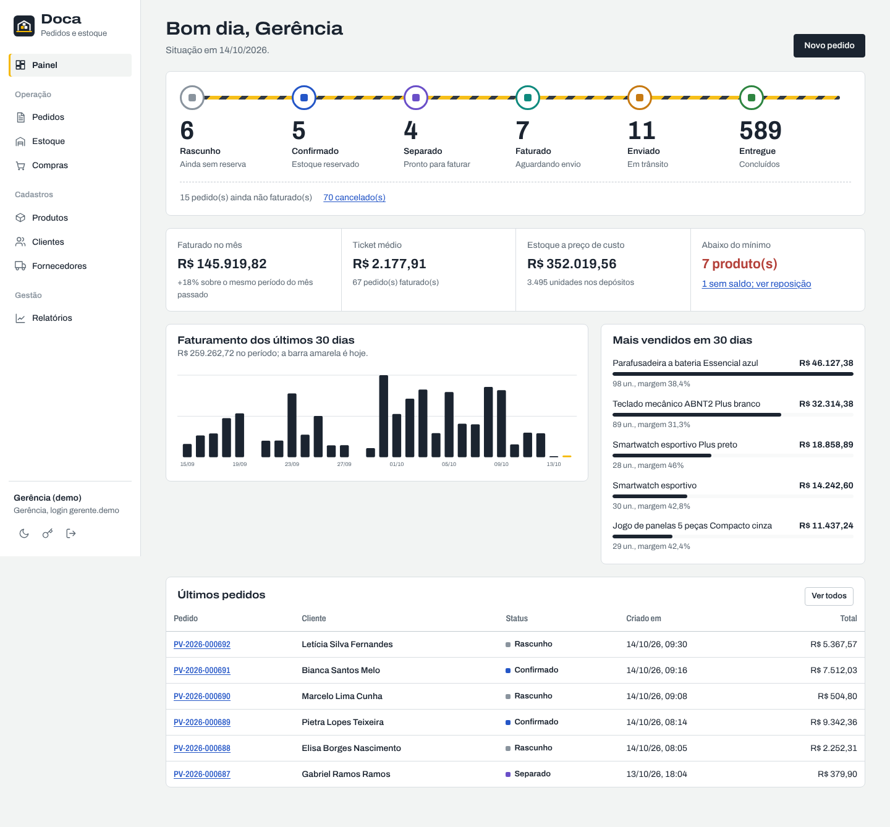
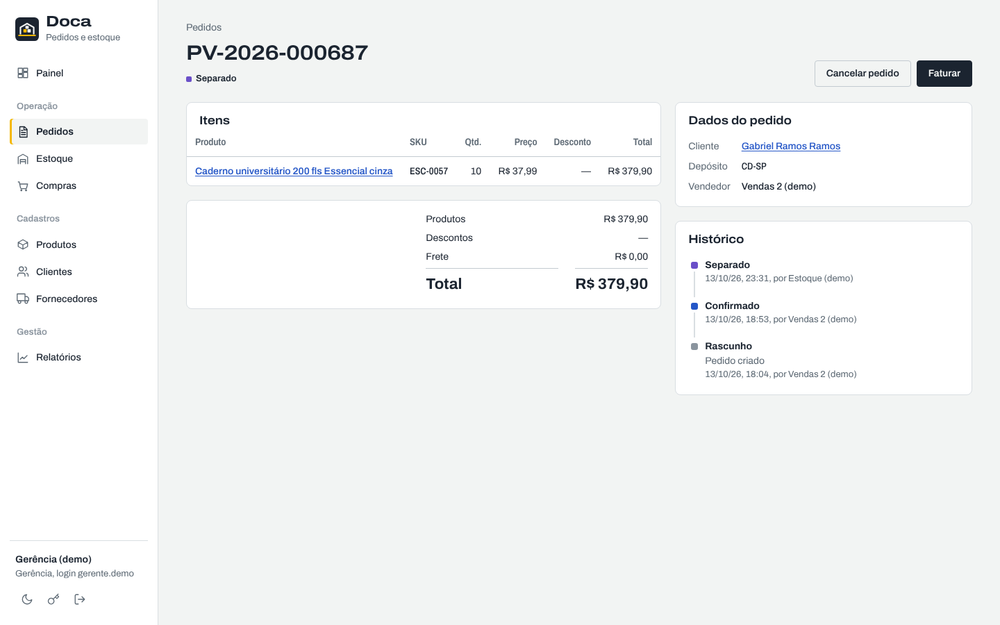
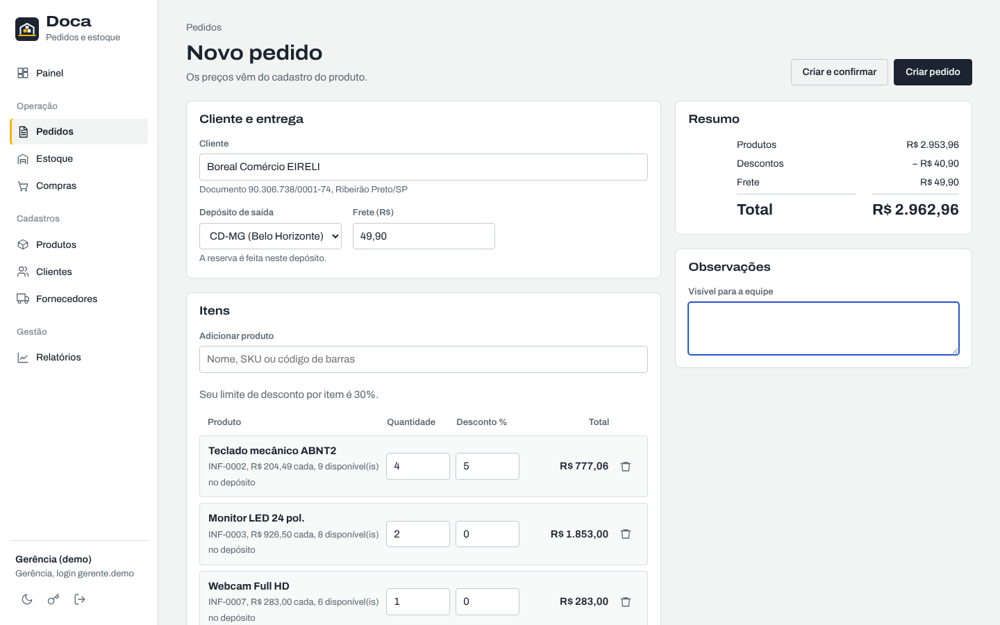
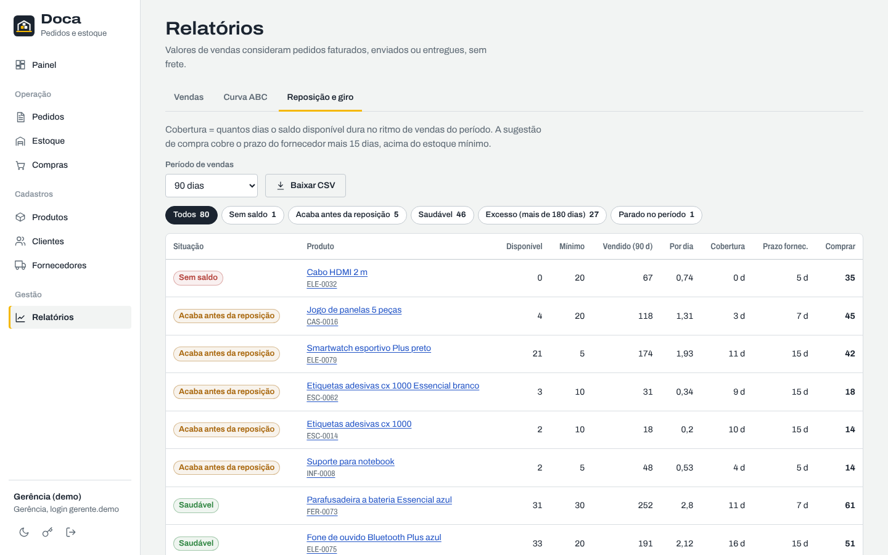
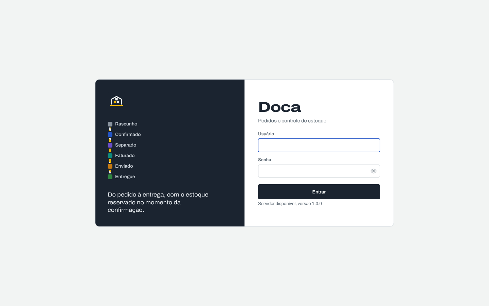
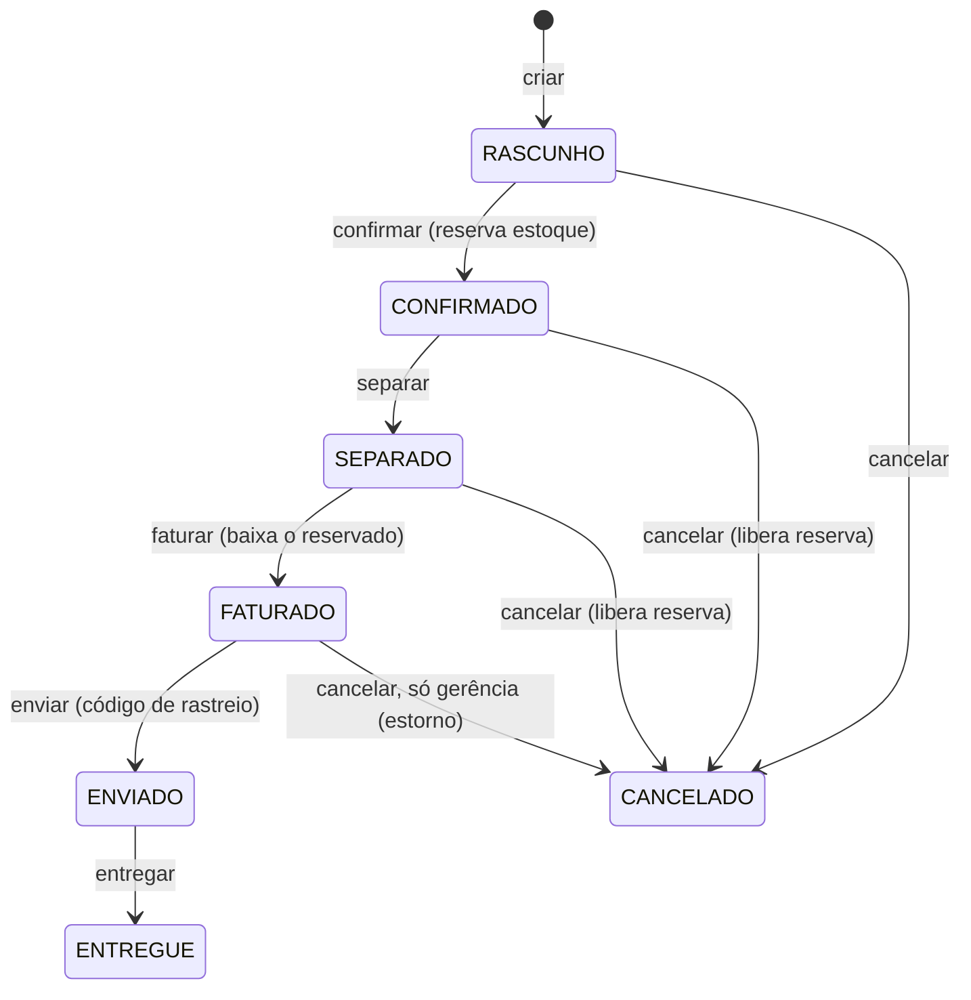
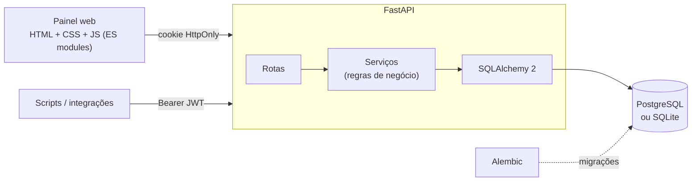
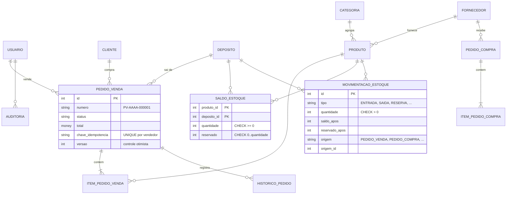
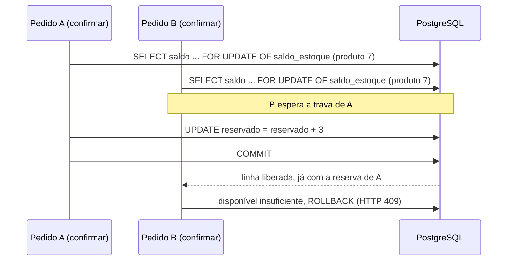

# Doca — Sistema de Pedidos e Controle de Estoque


Aplicação completa de **pedidos de venda, compras e estoque multi-depósito**: API REST em FastAPI, banco relacional com regras de integridade, painel web com login e perfis de acesso, relatórios gerenciais, auditoria, testes automatizados (inclusive de concorrência em PostgreSQL), Docker e integração contínua.

> Todos os dados de clientes, fornecedores e produtos são **fictícios**, gerados por script. Veja [Dados fictícios](#dados-fictícios).



## Sumário

- [O que o sistema faz](#o-que-o-sistema-faz)
- [Configurar na sua máquina](#configurar-na-sua-máquina)
- [Como rodar](#como-rodar)
- [Usando a API](#usando-a-api)
- [Regras de negócio](#regras-de-negócio)
- [Arquitetura](#arquitetura)
  - [Visão geral](#visão-geral)
  - [Camadas do código](#camadas-do-código)
  - [Modelo de dados](#modelo-de-dados)
  - [Decisões técnicas](#decisões-técnicas)
  - [Migrações do banco](#migrações-do-banco)
- [Segurança e privacidade](#segurança-e-privacidade)
- [Testes e qualidade](#testes-e-qualidade)
- [Estrutura de pastas](#estrutura-de-pastas)
- [Dados fictícios](#dados-fictícios)
- [Licença](#licença)

## O que o sistema faz

| Área | Recursos |
|---|---|
| **Pedidos de venda** | Rascunho editável, confirmação com reserva de estoque, separação, faturamento, envio com rastreio, entrega e cancelamento com liberação de reserva ou estorno. Histórico completo de cada mudança. |
| **Estoque** | Saldos por depósito (físico, reservado e disponível), entradas, ajuste por contagem (inventário), transferências entre depósitos e um livro de movimentações imutável. |
| **Compras** | Pedido ao fornecedor, envio, recebimento total ou parcial e recálculo do custo médio ponderado. |
| **Cadastros** | Produtos (SKU, EAN-13, categoria, fornecedor, preço, estoque mínimo), clientes PF/PJ com validação de CPF/CNPJ, fornecedores e depósitos. |
| **Relatórios** | Painel com esteira de pedidos e indicadores; vendas por dia, semana, mês, categoria, produto, vendedor, cliente ou UF; curva ABC; giro, cobertura em dias e sugestão de compra. Exportação em CSV. |
| **Administração** | Usuários com quatro perfis, senha provisória com troca obrigatória e trilha de auditoria. |

### Telas

<table>
  <tr>
    <td></td>
    <td></td>
  </tr>
  <tr>
    <td></td>
    <td></td>
  </tr>
</table>

## Configurar na sua máquina

O repositório não traz senhas, chaves nem dados de ninguém. Cada pessoa define os próprios valores no arquivo `.env`, que fica só no seu computador e nunca vai para o Git.

### Fase 1 — Criar o seu `.env`

Copie o modelo:

```bash
cp .env.example .env        # Windows (PowerShell): Copy-Item .env.example .env
```

Os scripts `iniciar.bat` e `iniciar.sh` fazem essa cópia sozinhos na primeira execução.

### Fase 2 — Preencher os valores

Abra o `.env` num editor de texto e preencha conforme o uso:

| Variável | Quando preencher | O que colocar |
|---|---|---|
| `CHAVE_SECRETA` | Obrigatória no Docker e em produção | Uma chave longa e aleatória (comando abaixo). Em uso local pode ficar vazia: uma chave é gerada em `dados/`. |
| `ADMIN_USUARIO` | Opcional | Login do primeiro administrador. Vazio = `admin`. |
| `ADMIN_SENHA` | Opcional | Senha do primeiro administrador. Vazia = uma senha aleatória é gravada em `dados/senha_inicial_admin.txt`. |
| `SENHA_DEMO` | Opcional | Senha dos usuários de demonstração. Vazia = gerada na hora e gravada em `dados/credenciais_demo.txt`. |
| `POSTGRES_BANCO` | Obrigatória no Docker | Nome do banco, por exemplo `estoque`. |
| `POSTGRES_USUARIO` | Obrigatória no Docker | Usuário do banco que você quer criar. |
| `POSTGRES_SENHA` | Obrigatória no Docker | Senha forte do banco, só com letras, números, `-` e `_`. |
| `PORTA_API` / `PORTA_BANCO` | Opcional | Portas no seu computador. Padrão `8000` e `5432`. |
| `DATABASE_URL` | Opcional (uso local) | Padrão: SQLite em `dados/`. Para um PostgreSQL seu: `postgresql://<usuario>:<senha>@<servidor>:5432/<banco>`. |
| `COOKIE_SEGURO` | Produção | `true` quando o sistema estiver atrás de HTTPS. |

Para gerar a `CHAVE_SECRETA`:

```bash
python -c "import secrets; print(secrets.token_urlsafe(48))"
```

### Fase 3 — Conferir

- O `.env` está listado no `.gitignore`. Rode `git status` e confirme que ele não aparece.
- A pasta `dados/`, com banco local, chave e senhas geradas, também é ignorada pelo Git.

## Como rodar

### Opção 1 — Windows, com dois cliques

Pré-requisito: [Python 3.12 ou superior](https://www.python.org/downloads/).

1. Baixe ou clone o repositório.
2. Dê dois cliques em **`iniciar.bat`**.
3. Na primeira vez ele cria o `.env`, o ambiente virtual, instala as dependências e gera seis meses de operação fictícia. As senhas de demonstração aparecem na janela e ficam salvas em `dados/credenciais_demo.txt`.
4. O navegador abre em <http://127.0.0.1:8000>.

No Linux ou macOS, use `./iniciar.sh`.

### Opção 2 — manual

```bash
cp .env.example .env
python -m venv .venv
.venv\Scripts\activate            # Windows  (Linux/macOS: source .venv/bin/activate)
pip install -r requirements-dev.txt
python -m scripts.popular_banco   # dados fictícios (use --limpar para recomeçar)
uvicorn app.main:app --reload --host 127.0.0.1
```

### Opção 3 — Docker (PostgreSQL + API)

1. Faça as fases de [Configurar na sua máquina](#configurar-na-sua-máquina), preenchendo `CHAVE_SECRETA`, `POSTGRES_BANCO`, `POSTGRES_USUARIO` e `POSTGRES_SENHA`.
2. Suba os serviços:

   ```bash
   docker compose up -d --build
   docker compose logs api        # mostra as credenciais de demonstração
   ```

3. Acesse <http://127.0.0.1:8000> (ou a porta definida em `PORTA_API`).

Se alguma variável obrigatória estiver vazia, o Docker para e avisa qual falta. As portas ficam presas a `127.0.0.1`, ou seja, só o próprio computador acessa.

## Usando a API

A documentação interativa fica em **<http://127.0.0.1:8000/docs>** (Swagger) e `/redoc`.

```bash
# 1. Entrar e guardar o token
TOKEN=$(curl -s -X POST http://127.0.0.1:8000/api/v1/auth/login \
  -H "Content-Type: application/json" \
  -d '{"usuario": "<seu-usuario>", "senha": "<sua-senha>"}' | python -c "import sys,json;print(json.load(sys.stdin)['access_token'])")

# 2. Criar um pedido (repetir com a mesma chave não duplica)
curl -X POST http://127.0.0.1:8000/api/v1/pedidos \
  -H "Authorization: Bearer $TOKEN" -H "Content-Type: application/json" \
  -H "Idempotency-Key: pedido-exemplo-001" \
  -d '{"cliente_id": 1, "deposito_id": 1, "frete": "19.90",
       "itens": [{"produto_id": 3, "quantidade": 2, "desconto_percentual": 5}]}'

# 3. Confirmar (reserva o estoque)
curl -X POST http://127.0.0.1:8000/api/v1/pedidos/1/confirmar -H "Authorization: Bearer $TOKEN"
```

Principais grupos de rotas (prefixo `/api/v1`):

| Grupo | Rotas |
|---|---|
| Autenticação | `POST /auth/login`, `/auth/logout`, `/auth/trocar-senha`, `/auth/sair-de-todos`, `GET /auth/eu` |
| Pedidos | `GET/POST /pedidos`, `GET/PATCH /pedidos/{id}`, `PUT /pedidos/{id}/itens`, `POST /pedidos/{id}/confirmar · separar · faturar · enviar · entregar · cancelar`, `GET /pedidos/exportar` |
| Estoque | `GET /estoque/saldos`, `GET /estoque/movimentacoes`, `POST /estoque/entradas · ajustes · transferencias` |
| Compras | `GET/POST /compras`, `POST /compras/{id}/enviar · receber · cancelar` |
| Cadastros | `/produtos`, `/categorias`, `/fornecedores`, `/clientes`, `/depositos`, `/usuarios` |
| Relatórios | `/relatorios/dashboard`, `/relatorios/vendas`, `/relatorios/curva-abc`, `/relatorios/giro-estoque` (todos com `formato=csv`) |

Erros seguem sempre o mesmo formato:

```json
{ "erro": { "codigo": "estoque_insuficiente", "mensagem": "Estoque disponível insuficiente para confirmar o pedido.",
            "detalhes": [{ "sku": "INF-0003", "disponivel": 4, "solicitado": 6 }] } }
```

## Regras de negócio

### Ciclo do pedido



- **Reserva atômica:** ao confirmar, todos os itens são reservados ou nenhum. As linhas de saldo são travadas com `SELECT … FOR UPDATE` sempre na mesma ordem (por produto), o que evita *deadlock* e venda acima do estoque mesmo com vários pedidos confirmados ao mesmo tempo. Há um teste que dispara 20 confirmações simultâneas para 5 unidades e verifica que exatamente 5 passam. Detalhes em [Reserva sem venda dupla](#reserva-sem-venda-dupla).
- **Disponível = físico − reservado.** O banco garante por `CHECK` que nenhum saldo fica negativo e que a reserva nunca passa do físico.
- **Desconto por perfil:** vendas até 10%, gerência até 30%, administração sem limite.
- **Limite de crédito:** pedidos que ultrapassam o limite do cliente (somando pedidos em aberto) são barrados para vendas e liberados pela gerência, com registro no histórico.
- **Custo médio ponderado** recalculado a cada recebimento; o custo é congelado no item do pedido para que a margem histórica não mude.
- **Idempotência:** `POST /pedidos` aceita o cabeçalho `Idempotency-Key`; repetir a requisição devolve o mesmo pedido em vez de duplicar.
- **Controle otimista de versão** em produtos e pedidos: duas pessoas editando o mesmo registro não sobrescrevem uma à outra (HTTP 409).

### Perfis

| Ação | Administração | Gerência | Vendas | Estoque |
|---|:-:|:-:|:-:|:-:|
| Criar, editar e confirmar pedidos | ✓ | ✓ | ✓ (os seus) | |
| Separar, faturar, enviar, entregar | ✓ | ✓ | | ✓ |
| Cancelar pedido faturado (estorno) | ✓ | ✓ | | |
| Entrada, ajuste e transferência de estoque | ✓ | ✓ | | ✓ |
| Criar compras / receber mercadoria | ✓ / ✓ | ✓ / ✓ | | — / ✓ |
| Cadastrar produtos e preços | ✓ | ✓ | | |
| Relatórios de vendas e curva ABC | ✓ | ✓ | | |
| Ver CPF completo do cliente | ✓ | ✓ | revelar (auditado) | |
| Usuários e auditoria | ✓ | | | |

## Arquitetura

### Visão geral



| Camada | Tecnologia |
|---|---|
| API | FastAPI, Pydantic v2, Uvicorn |
| Banco | SQLAlchemy 2 (ORM tipado), Alembic, PostgreSQL 17 (SQLite para desenvolvimento) |
| Autenticação | JWT (PyJWT) com revogação por versão, senhas com scrypt, bloqueio por tentativas |
| Interface | HTML, CSS e JavaScript puros, sem build e sem CDN; fonte Archivo servida localmente |
| Qualidade | Pytest (80 testes, também rodando em PostgreSQL), Ruff, GitHub Actions |
| Entrega | Dockerfile com usuário sem privilégios, Docker Compose com healthchecks |

### Camadas do código

| Pasta | Responsabilidade |
|---|---|
| `app/rotas/` | HTTP: autenticação, permissão por perfil, paginação e formato da resposta |
| `app/servicos/` | Regras de negócio, sem nada de HTTP (reaproveitadas pelo gerador de dados fictícios) |
| `app/modelos/` | Tabelas e restrições do banco (`CHECK`, chaves únicas, índices) |
| `app/esquemas/` | Validação de entrada e formato de saída com Pydantic |

As rotas abrem a transação, chamam o serviço e fazem `commit` uma única vez. Se qualquer regra falhar, nada é gravado.

### Modelo de dados



| Tabela | O que guarda |
|---|---|
| `produto`, `categoria`, `fornecedor`, `deposito` | Cadastros |
| `cliente` | Pessoas físicas e jurídicas, com documento validado e limite de crédito |
| `saldo_estoque` | Quantidade física e reservada de cada produto em cada depósito |
| `movimentacao_estoque` | Livro imutável de tudo que alterou um saldo |
| `pedido_venda`, `item_pedido_venda`, `historico_pedido` | Pedidos, itens com preço e custo congelados, e cada mudança de status |
| `pedido_compra`, `item_pedido_compra` | Compras e quanto de cada item já foi recebido |
| `usuario`, `auditoria` | Acesso por perfil e trilha de quem fez o quê |

### Decisões técnicas

#### Dinheiro como inteiro de centavos

O tipo `Dinheiro` (`app/database.py`) guarda valores como `BIGINT` em centavos e devolve `Decimal` com duas casas. Isso evita erros de ponto flutuante e funciona igual em PostgreSQL e SQLite. Somas feitas no banco (`SUM`) continuam exatas porque o resultado passa pelo mesmo conversor.

#### Saldo e livro de movimentações

`saldo_estoque` tem o número atual, rápido de ler; `movimentacao_estoque` é o histórico imutável, com o saldo depois de cada operação. Toda alteração de saldo passa por `app/servicos/estoque.py`, que grava as duas coisas na mesma transação. O último `saldo_apos` de cada par produto/depósito sempre bate com o saldo atual.

#### Reserva sem venda dupla



- As travas são pegas sempre em ordem crescente de produto, então dois pedidos com os mesmos itens nunca travam um ao outro em ciclo.
- `FOR UPDATE OF saldo_estoque` trava só a tabela de saldo, mesmo com relacionamentos carregados por `LEFT JOIN` (o PostgreSQL não permite travar o lado opcional de um join).
- Os `CHECK` do banco são a última linha de defesa caso algum código futuro esqueça a regra.
- `tests/test_concorrencia.py` dispara 20 confirmações simultâneas para 5 unidades e exige exatamente 5 sucessos.

#### Máquina de estados declarativa

`TRANSICOES` em `app/servicos/pedidos.py` define, para cada ação, de quais status ela parte, para qual vai e quais perfis podem executá-la. A mesma tabela alimenta a validação no servidor e o campo `acoes_disponiveis`, que o painel usa para mostrar só os botões permitidos.

#### Autenticação

- JWT HS256 com validade curta, emissor fixo e campo `ver` (versão do token do usuário). Aumentar `versao_token` invalida todas as sessões daquele usuário sem precisar de lista negra.
- O painel recebe o token em cookie `HttpOnly; SameSite=Strict`, inacessível a JavaScript. Integrações usam o mesmo token em `Authorization: Bearer`.
- Requisições de escrita com cookie e `Origin` de outro site são recusadas pelo middleware.

#### Fuso horário

Datas são gravadas em UTC (`DataHoraUTC`). Relatórios agrupam por dia no fuso `America/Sao_Paulo`, convertendo os limites do período antes da consulta.

### Migrações do banco

`alembic/versions/` tem a estrutura inicial gerada a partir dos modelos. Para mudar o banco:

```bash
alembic revision --autogenerate -m "descreva a mudança"
alembic upgrade head
alembic check   # falha se os modelos e as migrações divergirem
```

No Docker, `docker/entrypoint.sh` aplica as migrações antes de subir a API.

## Segurança e privacidade

- Senhas com **scrypt** e sal individual; comparação em tempo constante; mesma resposta e mesmo tempo para usuário inexistente ou senha errada.
- **Bloqueio** temporário após 5 tentativas erradas (por origem e por usuário) e limite geral de requisições por minuto.
- Sessão do painel em **cookie HttpOnly + SameSite=Strict**; escrita vinda de outro site é recusada (proteção CSRF). Integrações usam `Authorization: Bearer`.
- Tokens revogáveis: trocar senha, desativar usuário ou mudar o perfil encerra todas as sessões.
- Cabeçalhos de segurança: CSP restritiva (sem scripts ou estilos de terceiros), `X-Frame-Options: DENY`, `nosniff`, `Referrer-Policy: no-referrer`, `Permissions-Policy`, HSTS quando em HTTPS.
- **Nenhum endereço IP é gravado.** A auditoria guarda só um código HMAC irreversível da origem, e os logs da aplicação não registram IP.
- **CPF mascarado** para perfis operacionais; revelar o documento fica registrado na auditoria (princípio da necessidade, LGPD).
- Consultas sempre parametrizadas (ORM), buscas com curingas escapados e validação de entrada com Pydantic.
- A interface não carrega nada de fora (sem Google Fonts, CDNs ou analytics), então o navegador de quem usa não é exposto a terceiros.
- Nenhum segredo no repositório: cada instalação define os seus no `.env`. O `.env`, a pasta `dados/` e os bancos locais estão no `.gitignore`.

## Testes e qualidade

```bash
pytest                                  # SQLite em memória
pytest --cov                            # com cobertura
TEST_DATABASE_URL=postgresql://<usuario>:<senha>@localhost:5432/<banco_de_teste> pytest   # inclui o teste de concorrência
ruff check . && ruff format --check .
alembic upgrade head && alembic check   # migrações batem com os modelos
```

A integração contínua (`.github/workflows/ci.yml`) roda lint, a suíte completa em SQLite **e** em PostgreSQL, o ciclo de migrações, a geração dos dados de demonstração e o build da imagem Docker.

## Estrutura de pastas

```
├── app/
│   ├── main.py            # criação do app, middlewares, rotas e arquivos estáticos
│   ├── config.py          # configurações via variáveis de ambiente
│   ├── database.py        # engine, sessão e tipos (dinheiro exato, data/hora UTC)
│   ├── seguranca.py       # scrypt, JWT, limitador de login
│   ├── middleware.py      # cabeçalhos de segurança, CSRF, limite de requisições
│   ├── modelos/           # tabelas SQLAlchemy e enums
│   ├── esquemas/          # contratos de entrada e saída (Pydantic)
│   ├── servicos/          # regras de negócio: estoque, pedidos, compras, relatórios, auditoria
│   └── rotas/             # endpoints da API
├── web/                   # painel (HTML, CSS, JS, fonte e ícone)
├── alembic/               # migrações do banco
├── scripts/               # gerador de dados fictícios
├── tests/                 # 80 testes (unidade, API e concorrência)
├── docs/                  # capturas de tela e guia de publicação
├── Dockerfile · docker-compose.yml
└── iniciar.bat · iniciar.sh
```

## Dados fictícios

O script `scripts/popular_banco.py` simula meses de operação passando pelas mesmas regras da API, então reservas, baixas e custos são coerentes entre si.

- Nomes de pessoas são combinações aleatórias de prenomes e sobrenomes comuns; empresas têm nomes inventados.
- CPFs e CNPJs são números aleatórios com dígitos verificadores válidos, só para passar na validação.
- E-mails usam os domínios reservados para exemplos (`example.com`, `example.org`, `example.net`).
- Códigos de barras usam o prefixo 2, faixa de circulação restrita que não identifica produtos do varejo.
- As senhas de demonstração são geradas na hora (ou definidas por você em `SENHA_DEMO`) e ficam só no seu computador (`dados/`, fora do Git).

Qualquer semelhança com pessoas ou empresas reais é coincidência.

## Licença

[MIT](LICENSE). A fonte Archivo é distribuída sob a [SIL Open Font License](web/fonts/OFL-Archivo.txt).
